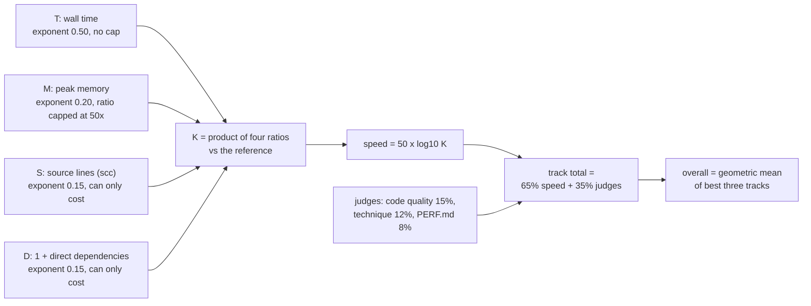
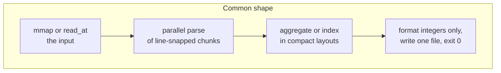
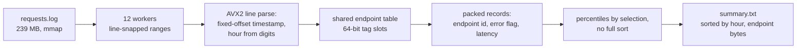
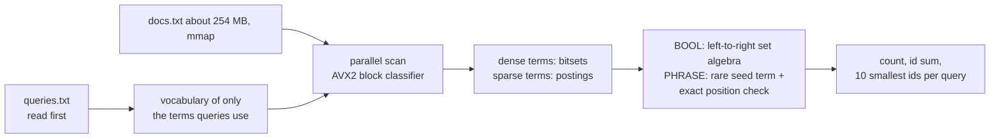
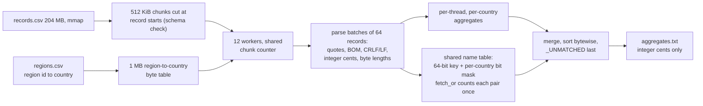
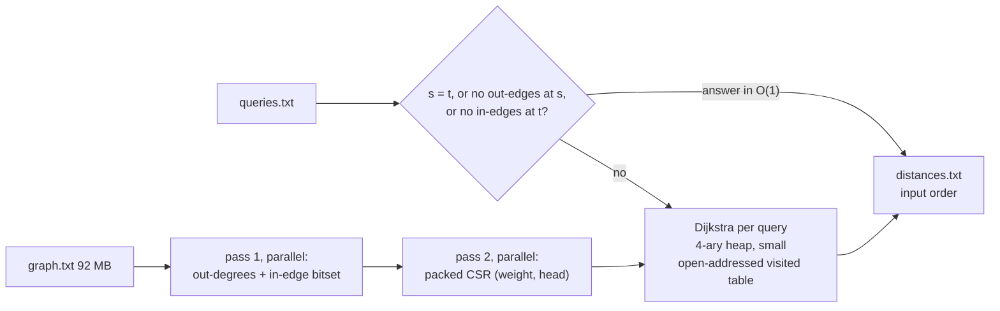
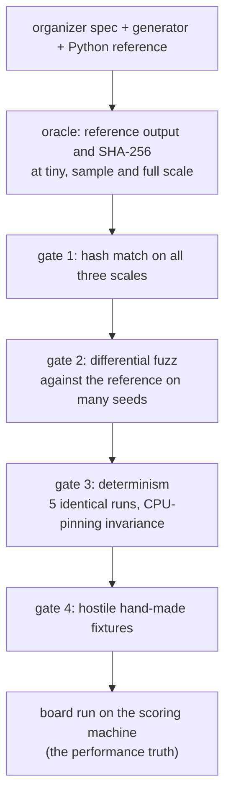
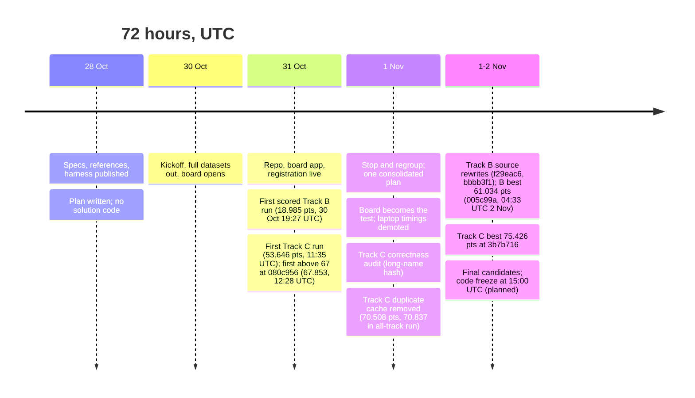

<div align="center">

# Ganondorf — Speed Demon 2026

**Four tracks. One standard library. Zero dependencies. Every claim backed by a board run.**


-b7410e?style=for-the-badge)


[Event page](https://speeddemon.dev) · [Organizer repo](https://github.com/hackathon-raptors/speed-demon-2026) · [Live board data feed](https://s3.amazonaws.com/raptors.dev/speeddemon.dev/2026/board/board.json)

</div>

---

## Contents

1. [Results at a glance](#1-results-at-a-glance)
2. [How scoring works, and where our points come from](#2-how-scoring-works-and-where-our-points-come-from)
3. [Repository layout](#3-repository-layout)
4. [The four solutions](#4-the-four-solutions)
5. [How we kept ourselves honest](#5-how-we-kept-ourselves-honest)
6. [Timeline](#6-timeline)
7. [What did not work](#7-what-did-not-work)
8. [Reproduce it](#8-reproduce-it)
9. [Rules compliance checklist](#9-rules-compliance-checklist)
10. [AI tooling disclosure](#10-ai-tooling-disclosure)
11. [Known problems and open items](#11-known-problems-and-open-items)
12. [With another 24 hours](#12-with-another-24-hours)
13. [Team](#13-team)
14. [Licence](#14-licence)

---

## 1. Results at a glance

The overall title is the **geometric mean of the best three track totals**. The board's overall figure uses machine speed points (`50 × log10 K`). The judges' 35% is added by the organizers after freeze, so the figures here are speed points only.

| Track | Task | Speed pts | K | Time | Memory | Source lines | Board commit | Counts toward overall |
|---|---|---:|---:|---:|---:|---:|---|:---:|
| **A** | Ingest: 3.1 M log lines to per-endpoint percentiles | **76.902** | 34.516892 | 0.037 s | 23 MB | 423 | `64925b1` | yes |
| **B** | Index: 50,000 boolean and phrase queries over about 250 MB | **61.034** | 16.622063 | 0.297 s | 122 MB | 1,235 | `005c99a` | yes |
| **C** | Join: hostile 204 MB CSV joined and aggregated | **75.426** | 32.249688 | 0.042 s | 9 MB | 371 | `3b7b716` | yes |
| **D** | Traverse: 2,000 shortest paths on a 5 M-edge graph | 48.692 | 9.415483 | 0.917 s | 135 MB | 369 | `5792950` | dropped (weakest) |

**Overall (geometric mean of A, B, C): 70.742.** Checked by hand: `(76.902 × 61.034 × 75.426)^(1/3) = 70.742`.

```text
Speed points (log scale: K = 10 → 50, K = 100 → 100)

A  ███████████████████████████████░░░░░░░░░  76.9
C  ██████████████████████████████░░░░░░░░░░  75.4
B  ████████████████████████░░░░░░░░░░░░░░░░  61.0
D  ███████████████████░░░░░░░░░░░░░░░░░░░░░  48.7  (dropped)
```

**Speed-up over the organizers' reference** (reference times as used in the scoring formula; ratios computed from our board times):

| Track | Reference time | Ours | Speed-up | Memory vs reference |
|---|---:|---:|---:|---:|
| A | 32.05 s | 0.037 s | ≈ 866× | 9.9× smaller |
| B | 56.35 s | 0.297 s | ≈ 190× | 18× smaller |
| C | 14.44 s | 0.042 s | ≈ 344× | 40.8× smaller |
| D | 72.69 s | 0.917 s | ≈ 79× | 6.6× smaller |

> **Run IDs are replaced by commit IDs.** The raw board feed did not give a run ID for every run. Every board result in this README and in the track `PERF.md` files is therefore identified by the commit that was scored. Run IDs that we did receive are kept in [`runs_ledger.md`](runs_ledger.md). Where a result has no recorded commit, it is marked "not recorded" rather than filled in.

> **Full board history.** Every push the board scored for this team is listed, with its commit, in each track's `PERF.md`: Track A, Track B (53 pushes, 47 scored, 6 failed to build), Track C (43 pushes, 39 scored, 4 failed), and Track D. Times are UTC, as in the board feed. Team notes sometimes give IST dates, which are noted where they differ.

> **Board runs are noisy.** Identical code has moved by about 1 to 3 points between runs. Differences smaller than that are not evidence of a change, and we do not claim them as such. See the `PERF.md` file in each track folder.

---

## 2. How scoring works, and where our points come from



```text
K = (Tref/T)^0.50 × min(Mref/M, 50)^0.20 × min(Sref/S, 1)^0.15 × min(Dref/D, 1)^0.15
```

Where our K comes from, per axis. The Track C and Track B rows are derived from the reference values and our board numbers. The Track A and D rows are carried over from an earlier table and have not been re-derived in this update.

| Track | Time factor | Memory factor | Source-size factor | Dependency factor | K (board) |
|---|---:|---:|---:|---:|---:|
| A | × 29.4 | × 1.58 | × 0.74 (earlier table) | × 1.00 | 34.52 |
| B | × 13.8 | × 1.78 | × 0.68 | × 1.00 | 16.62 |
| C | × 18.5 | × 2.10 | × 0.83 | × 1.00 | 32.25 |
| D | × 8.9 | × 1.46 | × 0.72 (earlier table) | × 1.00 | 9.42 |

The C row multiplies to about 32.35 against the board's 32.25. The gap is the rounding of T to two significant figures.

Two things follow from the formula and shaped our decisions:

- **Time dominates.** Halving runtime multiplies K by 1.41. Halving memory multiplies K by only 1.15. Doubling source lines costs a factor of 0.90. Source size cost us between 17% and 32% of K on each track, which is why compaction was a real lever.
- **Zero dependencies is free points.** Each direct runtime dependency costs a factor of 0.90. All four tracks use the Rust standard library only (`dependency_count = 0`), so D = 1 on every track.

---

## 3. Repository layout

```text
.
├── README.md              this file
├── PLAN.md                the team operating plan: roles, gates, guardrails, cut order
├── check.py               organizers' build-and-run check (needs Docker)
├── track-a/               Ingest    — Dockerfile, Cargo.toml, src/main.rs, PERF.md, README.md
├── track-b/               Index     — same shape
├── track-c/               Join      — same shape
├── track-d/               Traverse  — same shape
├── fixtures/              correctness oracle: data generation, reference runs, hash compare,
│                          fuzz scripts, hand-made hostile cases (never inside a track folder)
├── scripts/               tooling: K calculator, S/D static axes, board push, clean-room rehearsal
├── runs_ledger.md         every board run and local experiment we logged, with the run IDs we received
└── LICENSE                MIT
```

Rule we kept: **tests and tooling never live inside a `track-*` folder**, because everything in the folder counts toward S.

Each track folder holds what the board builds, plus its documentation:

| File | Purpose |
|---|---|
| `Dockerfile` | Two stages, allowlisted images pinned by digest, offline build, `RUSTFLAGS="-C target-cpu=x86-64-v3"` set inline |
| `Cargo.toml` | `opt-level=3`, fat LTO, one codegen unit, `panic=abort`; no dependencies |
| `.speed-demon.toml` | Track, team (`Ganondorf`), language, `dependency_count = 0` |
| `src/main.rs` | The solution |
| `PERF.md` | Complete measurement record for the track: every board result, local experiment and discrepancy |
| `README.md` | Approach, current result, verification steps and known limits for the track |

---

## 4. The four solutions

All four are single-binary Rust, standard library only, built for `x86-64-v3` (AVX2; the scoring box is an i5-13500 with no AVX-512), and use at most the 12 threads the harness provides.



### Track A — Ingest

*3.1 M structured log lines → per-(hour, endpoint) counts, nearest-rank p50/p95/p99, error rate.* Reference: 32.05 s, 228 MB.



- **Parse:** hand-rolled, fixed-offset timestamp handling; hour index from digit arithmetic rather than a date library.
- **Endpoint identity:** one shared open-addressed table, so there are no per-thread tables to remap afterwards.
- **Percentiles:** nearest rank, `(p·n + 99) div 100`, found by selection rather than full sorting.
- **Memory:** records packed small; buffers released before the output file is written.
- **Result:** 32.05 s → 0.037 s, 23 MB, 423 lines. This section comes from the earlier `track-a/README.md` and has not been re-checked against commit `64925b1` in this update.

### Track B — Index

*50,000 boolean (`AND`, `OR`, `NOT`, strictly left to right) and phrase queries over a corpus of about 250 MB.* Reference: 56.35 s, 2.2 GB.



- **Query-only index.** The spec allows indexing just the terms the queries use. This is the largest saving in both time and memory.
- **Lookup is tag-based, not exact.** The vocabulary table stores a 46-bit tag and a term id, and a hit is not checked against the full key. A false match is possible in principle; the source comment estimates about 1 in 10^7 per dataset. Earlier versions of this README said the full key was checked. That was wrong for the current source, and it is listed as an open risk in section 11.
- **Tokenisation** follows the spec byte for byte: every byte at or above 0x80 is a separator.
- **Phrases** use the rarest term as a seed, then check exact token positions.
- **Memory is the trade-off.** The best commit (`005c99a`, 61.034 points) uses 122 MB to reach 0.297 s. The previous plateau was 0.435 s at 67 MB (`c35a41d`). The latest push, `3b7b716`, scored 60.640 points (0.308 s, 122 MB).
- Details of the implementation are in [`track-b/README.md`](track-b/README.md).

### Track C — Join

*A hostile CSV (quoted commas, escaped quotes, embedded line feeds, mixed CRLF and LF, mid-file byte-order marks) joined to a region table, with exact distinct-name counts per country.* Reference: 14.44 s, 367 MB. This is the track where "a parser that is 3× faster and wrong scores zero".



- **Correctness first.** No floating point in any output path. Amounts are integer cents. Escaped lengths are counted exactly (a doubled quote counts once, and an embedded line feed counts once).
- **Distinct names in 10 MB.** Each distinct name gets a slot in a shared table with one bit per country. `fetch_or` returns the previous bit, so exactly one thread counts each `(name, country)` pair, with no post-pass.
- **A real bug found by audit.** An earlier name hash ignored the middle bytes of names longer than 32 bytes, so two different long names could be merged. A full-coverage hash on that path fixed it. The fixture that exposed it is described in `track-c/README.md`, but its generator is not in this repository snapshot.
- **Speed** came from batched parsing (64 records at a time) with software prefetch of the region and name-table entries, from removing the duplicate name cache, and from chunk scheduling by a shared counter. The `track-c/PERF.md` file records every board push (43, of which 39 were scored) and the open questions about how the prefetch change was introduced.
- **Result:** 14.44 s → 0.042 s, 9 MB, 371 lines. Memory is near the floor for this design, so the remaining lever is time.
- **Open item:** region ids of 1,000,000 or more are currently counted as unmatched. An earlier ledger entry describes a sparse path for longer region keys that we could not find in the current source. This must be resolved against the spec. See section 11.
- Details of the implementation are in [`track-c/README.md`](track-c/README.md).

### Track D — Traverse (not counted)

*5 M-edge directed graph, 2,000 shortest-path queries, parsing and layout decide most of the time.* Reference: 72.69 s, 893 MB. Entered and correct; dropped from the overall as our weakest track. This section comes from the earlier `track-d/README.md` and has not been re-checked in this update.



- Parallel CSR build took graph construction from 1,290 ms to 289 ms. Degree-zero shortcuts removed the worst unreachable-query sweeps.
- A single compact visited table replaced twelve dense per-thread distance arrays, cutting peak memory from about 220 MB to about 130 MB.
- Two ideas were measured and **rejected with evidence**: bidirectional search (settled nodes −38%, but time +528 ms and memory ×3.6 from doubled lookups) and BFS renumbering (net loss once the rebuild cost is paid). Details are in `track-d/PERF.md`.

### Per-track performance logs

Each track's `PERF.md` is the authoritative record. Milestones below are identified by commit, since run IDs were not available for every run.

<details>
<summary><b>Board history (points), checkpoints we kept</b></summary>

| Track | Milestone | Board commit | Speed pts |
|---|---|---|---:|
| A | Single-threaded Rust baseline | `832e2c8` (from earlier README) | 44.938 |
| A | Parallel, packed records | `f473810` | 59.903 |
| A | Mid-event plateau | `c6ef5cf` | 66.971 |
| A | All-track run | `c35a41d` | 73.053 |
| A | Current | `64925b1` | **76.902** |
| B | First scored board run (early baseline, 30 Oct 19:27 UTC) | `40ad00c` | 18.985 |
| B | v2.5 | `272dc82` | 53.728 |
| B | Best of the mid phase | `5792950` | 58.353 |
| B | Tagged vocabulary and block tokenizer | `b22f4e2` | 60.015 |
| B | All-track run | `c35a41d` | 59.852 |
| B | Current | `005c99a` | **61.034** |
| C | First board run (31 Oct 11:35 UTC) | `a3f64b1` | 53.646 |
| C | First run above 67 points (31 Oct 12:28 UTC) | `080c956` | 67.853 |
| C | Duplicate cache removed | `7580e12` | 70.508 |
| C | All-track run | `c35a41d` | 70.837 |
| C | Current | `3b7b716` | **75.426** |
| D | First parallel version | `272dc82` | 38.365 |
| D | Step change (memory and parse work) | `eabc130` | 48.039 |
| D | Current | `5792950` | 48.692 |

The A, B and C rows for earlier milestones come from the track `PERF.md` files, which hold the complete sequence. The A and D rows are from the earlier root README and are not re-checked here.

</details>

---

## 5. How we kept ourselves honest

Correctness is a gate, not a score: one wrong byte, or one flaky run in five, is a zero for the track. We split the team so that the person who writes a track is not the only person who trusts it.



**Expected output hashes (seed 1).** The `full` values are the organizers' published ones. Each solution's output matches them.

| Track | Output file | tiny | sample | full (spec) |
|---|---|---|---|---|
| A | `summary.txt` | `c24fa507c963…` | `ca6311bbeb53…` | `495ca09682b9…` |
| B | `results.txt` | `dcdad7cedfc0…` | `eeeec1e9319d…` | `f86973c21022…` |
| C | `aggregates.txt` | `e4e43bc39920…` | `9035fed36823…` | `d8088b1cd42b…` |
| D | `distances.txt` | `ecaca77d3221…` | `a4c76ed030bc…` | `a23dbdf0a3e4…` |

<details>
<summary><b>Full SHA-256 values</b></summary>

```text
A summary.txt
  tiny    c24fa507c963eaeac9224fd8435019b4f4e8c002ece7e32f316681a3957eb92f
  sample  ca6311bbeb536fa55d85265bf6fd3d24cc9586f13de1ac73bd2a23ac3893aac3
  full    495ca09682b9673ef836a506496177680bb4a3af54255174befddb1f83481cd3
B results.txt
  tiny    dcdad7cedfc07eb66ecced1861cc91d9017e004c56cbe4f38e9413b62b17ff70
  sample  eeeec1e9319da98a6f3c664c78f93e7078fd603c25c2bb3027174e81e3638a8f
  full    f86973c210228141bcb6f1f1b10188ad2a9b65f71e7cd7cf4590b38de4e80927
C aggregates.txt
  tiny    e4e43bc39920e9d446c3fcd700fdd35b3959e9495c6aaa738491df38a1aed733
  sample  9035fed36823232dd41ae2d1b9d6d21aa7c73f49d8e95647e953a89d5ebe9a66
  full    d8088b1cd42ba1338b1345b107b55db7b96ef1f5066f3ff64fd26a8912a0f536
D distances.txt
  tiny    ecaca77d3221fe3928109da36480cfdb39f288f2e57ecbc61d3d7706d5cb4bd5
  sample  a4c76ed030bc7e365db33191f6cf74708fba7f25eb48d64c8c4279f2e57046a0
  full    a23dbdf0a3e49cc8901310a9ee1dc6a9a569a85297b6da75c2a7002cb2ed277e
```

</details>

**Verification practices**

- **Oracle role.** One teammate owned the oracle: data generation with the organizers' generators, reference runs, expected hashes, fuzz and differential scripts. See `fixtures/`.
- **Fuzzing, as recorded.** Track A and D: 49 fuzz seeds plus thread-count invariance at 1, 2, 6 and 12 threads (from the earlier notes). Track B: tiny seeds 2 to 40 and sample seeds 2 to 6 through `fixtures/b_fuzz.sh`, and a full gate through `fixtures/b_gate.sh`. Track C: 300 seeds of differential fuzz against the reference on the local build, recorded in `track-c/PERF.md`.
- **Board is the performance truth.** Local timings on a laptop (WSL2, hybrid CPU) did not predict the scoring box. Paired local runs showed the second binary 7 to 27% slower regardless of which one it was. We kept changes only when the board agreed, and recorded the ones where it did not.
- **Hard rules** (from `PLAN.md`): no precomputed answers; integers only on output paths; every sort order total and bytewise; no panics on valid input; no timing code in the submitted binary; one change per experiment; never push work-in-progress to the board branch.
- **Source size discipline.** `scc` lines count after `rustfmt` defaults. Tests, scripts and generators stay outside track folders; Markdown, TOML and lockfiles are free.

---

## 6. Timeline



---

## 7. What did not work

Failed experiments are part of the record. They are also what the judges are told to reward.

| Area | What we tried | What happened | What we did |
|---|---|---|---|
| Process | `board_push.sh --track c` for a quick Track C test | The script resets every other track to the starter, so A, B and D vanished from the board for that run | Rule added: use `--all-tracks` with a complete candidate whenever other tracks matter |
| Measurement | Paired local timings on a hybrid-core laptop | Run order, not the code, decided the winner in 5 of 6 pairs | Declared the board the decision-maker; stopped trusting sub-5% local gains |
| Track B | Local "5.7% faster" source change (`e7c9ea6`) | Board went the other way: 0.417 s (`b22f4e2`) → 0.435 s (`c35a41d`) | Recorded as a board regression; the board result decided |
| Track B | Several memory and table-layout micro-experiments (B2a-x, B2b, B2c, B4, `25e6277`, `fbe7674`) | None passed the 3% paired keep rule, or the board regressed | Reverted; moved to a different scan structure instead |
| Track B | Source rewrites, 1-2 Nov (`f29eac6`, `bbbb3f1`, `2deeaab`, `21a5643`) | None of the four raised K above `faaeb9d` (16.122). Memory rose to 129–133 MB. The best result, `005c99a` (0.297 s, 122 MB), came after them and is 0.66 points above `faaeb9d` | The best result is kept. Memory is the open cost |
| Track B | Build failures | Six pushes failed to build (`c6ef5cf`, `82dbc51`, `d715004`, `ce0d3c1`, `3640ce1`, `6b67bfe`). Team account: the first four were mostly Rust build errors in pushes made before a local build was confirmed. The latest two (`3640ce1`, `6b67bfe`) built locally; a host-side error is suspected | Track C was scored at five of the six | Host-side error to be confirmed for the latest two |
| Track C | Smaller name table to save memory | Would overflow: 100,000 distinct names need 2^17 slots | Rejected on arithmetic, never coded |
| Track C | Dynamic scheduling with four chunks per thread (E2) | About 1% gain, below the 3% rule | Rejected |
| Track C | Early versions too slow | Three pushes hit the time limit on 31 Oct (`be71488`, `a49777a`, `5792950`) | Every push from `3fe70c9` onward was scored | Recorded |
| Track D | Bidirectional Dijkstra | Fewer settled nodes, but slower and 3.6× the memory | Rejected with measurements |
| Track D | BFS renumbering | Gain smaller than the cost of the rebuild plus 100 extra lines | Rejected |
| Same code, two runs | Identical Track C code (`3fe70c9`, `a52ad27`) scored 70.1 and 68.9 | About 1 point of run-to-run noise | Differences under about 3 points are treated as noise |

---

## 8. Reproduce it

You need Rust (the pinned Docker image is the exact board build), Python 3 for the generators, and Docker for the board-style check. The team's development machine (WSL2) does not have Docker, so the Docker step has not been run locally.

**1. Generate data with the organizers' generators** (seed 1 at `full` is the board's dataset):

```bash
git clone https://github.com/hackathon-raptors/speed-demon-2026 ~/sd-organizer
fixtures/gen_data.sh c 1 sample     # a|b|c|d  seed  tiny|sample|full
```

**2. Build one track the way the board does:**

```bash
cd track-c
RUSTFLAGS="-C target-cpu=x86-64-v3" cargo build --release --offline
```

**3. Run and compare against the published hash:**

```bash
fixtures/run_local.sh c track-c/target/release/solution ~/sd-data/sample/1/c <expected_sha256>
# or, exactly like the board (needs Docker):
python3 check.py c --data ~/sd-data/sample/1/c --expected <expected_sha256>
```

**4. Score arithmetic:**

```bash
python3 scripts/k_calc.py --track c -T 0.042 -M 9MB -S 371 -D 1
```

Track B's build and gate commands are in [`track-b/README.md`](track-b/README.md). Track C's are in [`track-c/README.md`](track-c/README.md).

---

## 9. Rules compliance checklist

Checked against the repository in this update where stated; otherwise the item is from an earlier check and is marked as such.

- [x] Rust standard library only; `dependency_count = 0` in the B and C `.speed-demon.toml` files (checked in this update). A and D from the earlier check.
- [x] Every Dockerfile `FROM` line is pinned by digest (checked for B in this update; the other tracks from the earlier check). Builds are offline.
- [x] Program reads `/data`, writes its output file to `/out`, and exits 0 (checked for B and C in this update).
- [x] No floating point in the output path of C (checked in this update); B and A from the earlier check.
- [x] Board app installed; team runs pushed to the `speed-demon` branch (from team records).
- [ ] Repo made **public** under an OSI licence at code freeze. Not verified in this update.
- [ ] Repo URL on the registration form matches this repo. Not verified in this update.
- [x] `PERF.md` in each entered track cites the scored commit for each board step. Run IDs were not available for every run, so commit IDs are used, as disclosed in section 1. Checked for B and C in this update.
- [ ] Optional `demo.mp4` (under 3 minutes). Not verified.
- [ ] Clean-room rehearsal: fresh clone, build from scratch, hash match. Not verified in this update.

---

## 10. AI tooling disclosure

AI tools are expected in this event. What matters is that a human understood every change. We used several coding agents and models during the 72 hours, including Codex (GPT 6 Luna), Antigravity, Gemini (the team's records name both "Gemini 4 Argon" and "Gemini 3.8 Flash"; to be confirmed before submission), and Claude (in chat, and as the coding agent once other agents ran out of quota). Agents wrote and refactored code under scoped task prompts. Humans owned the specs, the oracle, the review of each change against the spec, and every decision to keep or revert a change. Agent-reported passes counted for nothing until a human re-ran the hash.

Per-track detail is in each track's `README.md`. Where the team records do not say which tool wrote a given change, the track README says so rather than guessing.

---

## 11. Known problems and open items

These are problems we found while writing this update. They are listed here, not in the track READMEs only, because they affect the whole submission.

1. **Track B lookup is tag-based, not exact.** The vocabulary table compares a 46-bit tag and does not compare the full key on a hit. The source comment estimates a false match about once in 10^7 datasets, and the build keeps a seed only if every query term finds itself. Earlier documentation said the full key was checked, which was wrong for the current source. We have not proven the guarantee against the unseen holdout corpus. This is the main correctness risk on Track B. See `track-b/README.md`, "Known limits".
2. **Track C region ids of 1,000,000 or more.** The current source counts them as unmatched. An earlier ledger entry describes a sparse lookup for longer region keys that matched the reference on 300 seeds. We could not find that path in the current source. This must be resolved against the spec. See `track-c/PERF.md`, section 6.
3. **Track C prefetch history.** The current source batches 64 records with software prefetch. The earlier log records a rejected variant and reverted prefetch rings, and we could not find the entry that introduced the current batching. The board rows for the last three commits do not say which change produced them.
4. **"1 dep" (resolved).** The board displays one dependency for every entry, including ours. That is the standard library, which the formula counts as D = 1. Our zero external dependencies give D = 1 on every track, and no change to the scoring analysis is needed.
5. **Records that disagree.** The root README previously listed Track C as `0c55114` at 75.376 points; `0c55114` is a Track B commit, and the Track C current result is `3b7b716` at 75.426. The Track B README previously said the full key was checked, and the Track C README previously described carry-less multiplication, neither of which matches the source. These have been corrected in this update, and the corrections are recorded in each `PERF.md`. The first Track C board run was `a3f64b1` (53.646 points), not `080c956`.
6. **Correctness for the current commits is not fully recorded.** The local gate for `005c99a` (Track B) and the full seed-1 check for `3b7b716` (Track C) need to be run and recorded.
7. **Hostile fixture generator missing.** The Track C long-name fixture generator is named in earlier notes but is not in the repository.

---

## 12. With another 24 hours

Candidates we could not finish or measure properly. Track owners to confirm and rank.

- **Track C:** resolve item 2 in section 11 first, since it is a correctness question. Then reduce deduplication cost under the 10 MB cap, and reduce source size below 371 lines.
- **Track B:** make the lookup exact or prove the tag guarantee on the holdout corpus. Then investigate the memory growth from 67 MB to 122 MB, and profile the two corpus passes on the scoring host.
- **Track A:** further parser and percentile work; trim source size.
- **Track D:** the remaining headroom is in parsing and memory layout rather than the search loop.
- **All tracks:** `-C target-cpu=raptorlake` as a measured experiment; profile-guided optimisation committed as data.

---

## 13. Team

| | |
|---|---|
| **Team name** | Ganondorf |
| **Members** | Ashutosh Mishra, Shivam Mishra |
| **Role C: Correctness and oracle** | Ashutosh. Owned tracks B and C, the fixtures and the oracle, and repository ownership |
| **Role P: Platform and performance** | Shivam. Owned tracks A and D, Docker, and the scripts |
| **Discord** | am0007 |
| **Location / timezone** | IST |

---

## 14. Licence

MIT, as in [`LICENSE`](LICENSE) (the organizers' template licence). Reference code is copyright Hackathon Raptors CIC; our solutions are released under the same terms.