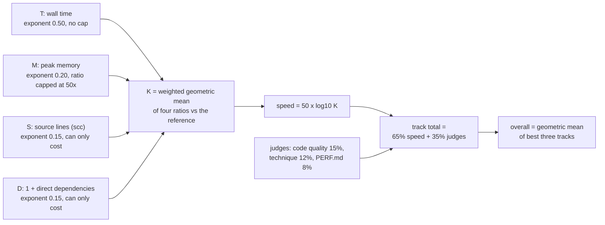
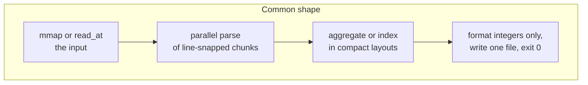
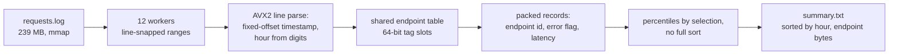
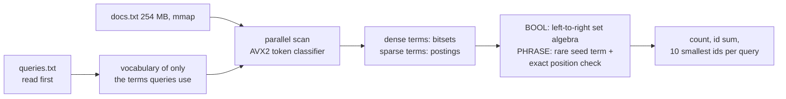
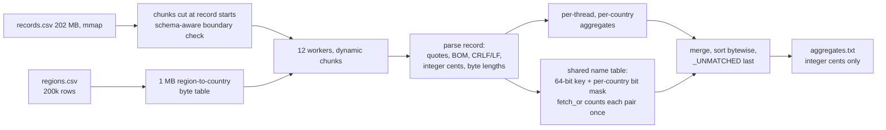
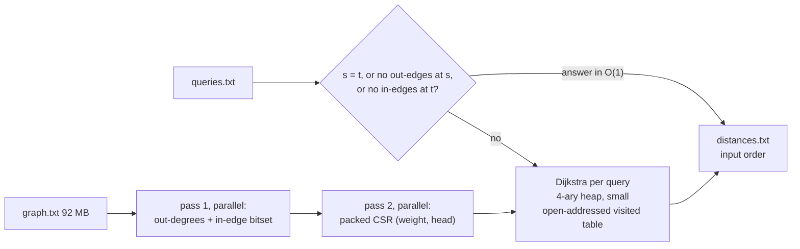
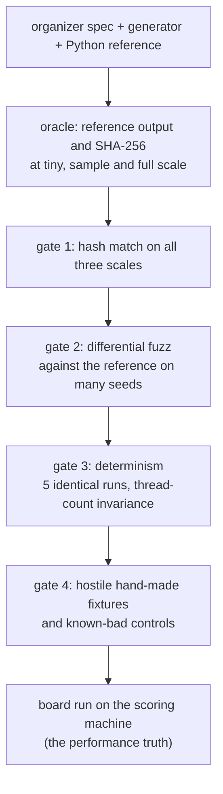
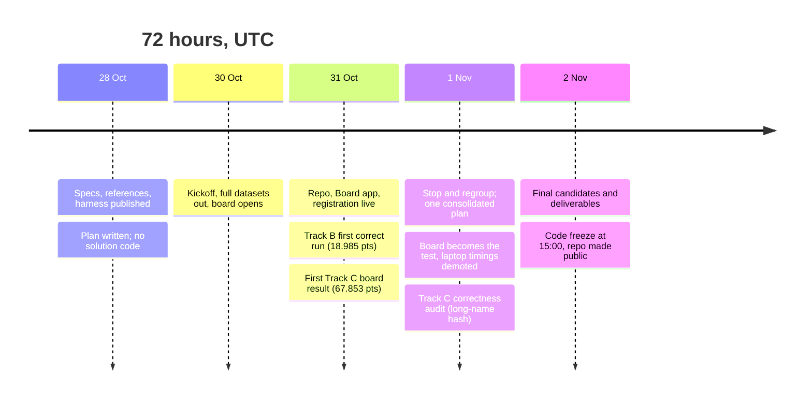

<div align="center">

# Ganondorf — Speed Demon 2026

**Four tracks. One standard library. Zero dependencies. Every claim backed by a board run.**


-b7410e?style=for-the-badge)


[Event page](https://speeddemon.dev) · [Organizer repo](https://github.com/hackathon-raptors/speed-demon-2026) · [Live board data feed](https://s3.amazonaws.com/raptors.dev/speeddemon.dev/2026/board/board.json)

</div>

---

## Contents

1. [Results at a glance](#1-results-at-a-glance)
2. [How scoring works, and where our points come from](#2-how-scoring-works-and-where-our-points-come-from)
3. [Repository layout](#3-repository-layout)
4. [The four solutions](#4-the-four-solutions)
5. [How we kept ourselves honest](#5-how-we-kept-ourselves-honest)
6. [Timeline](#6-timeline)
7. [What did not work](#7-what-did-not-work)
8. [Reproduce it](#8-reproduce-it)
9. [Rules compliance checklist](#9-rules-compliance-checklist)
10. [AI tooling disclosure](#10-ai-tooling-disclosure)
11. [With another 24 hours](#11-with-another-24-hours)
12. [Team](#12-team)
13. [Licence](#13-licence)

---

## 1. Results at a glance

The overall title is the **geometric mean of the best three track totals**. The board's overall figure uses machine speed points (`50 × log10 K`); the judges' 35% is added by the organizers after freeze.

| Track | Task | Speed pts | K | Time | Memory | Source lines | Commit | Board run ID | Counts toward overall |
|---|---|---:|---:|---:|---:|---:|---|---|:---:|
| **A** | Ingest: 3.1 M log lines to per-endpoint percentiles | **76.902** | 34.516892 | 0.037 s | 23 MB | 423 | `64925b1` | TBD | yes |
| **B** | Index: 50,000 boolean and phrase queries over 250 MB | **61.034** | 16.622063 | 0.297 s | 122 MB | 1,235 | `005c99a` | TBD | yes |
| **C** | Join: hostile 204 MB CSV joined and aggregated | **75.376** | 32.175409 | 0.041 s | 10 MB | 371 | `0c55114` | TBD | yes |
| **D** | Traverse: 2,000 shortest paths on a 5 M-edge graph | 48.692 | 9.415483 | 0.917 s | 135 MB | 369 | `5792950` | TBD | dropped (weakest) |

**Overall (geometric mean of A, B, C): 70.726** — checked by hand: `(76.902 × 75.376 × 61.034)^(1/3) = 70.726`.

```text
Speed points (0-100, log scale: K=10 -> 50, K=100 -> 100)

A  ███████████████████████████████░░░░░░░░░  76.9
C  ██████████████████████████████░░░░░░░░░░  75.4
B  ████████████████████████░░░░░░░░░░░░░░░░  61.0
D  ███████████████████░░░░░░░░░░░░░░░░░░░░░  48.7  (dropped)
```

**Speed-up over the organizers' naive Python reference** (reference times measured on the scoring machine):

| Track | Reference | Ours | Speed-up | Memory vs reference |
|---|---:|---:|---:|---:|
| A | 32.05 s | 0.037 s | ≈ 866× | 9.9× smaller |
| B | 56.35 s | 0.297 s | ≈ 190× | 18× smaller |
| C | 14.44 s | 0.041 s | ≈ 352× | 36.7× smaller |
| D | 72.69 s | 0.917 s | ≈ 79× | 6.6× smaller |

> Board runs are noisy: identical code has moved by about 1 to 3 points between runs. Differences smaller than that are not evidence of a change, and we do not claim them as such. See [PERF.md](#per-track-performance-logs) in each track folder.

---

## 2. How scoring works, and where our points come from



```text
K = (Tref/T)^0.50 × min(Mref/M, 50)^0.20 × min(Sref/S, 1)^0.15 × min(Dref/D, 1)^0.15
```

Where our K comes from, per axis (computed from the rounded board values above, so approximate):

| Track | Time factor | Memory factor | Source-size factor | Dependency factor | K (board) |
|---|---:|---:|---:|---:|---:|
| A | × 29.4 | × 1.58 | × 0.74 | × 1.00 | 34.52 |
| B | × 13.8 | × 1.78 | × 0.68 | × 1.00 | 16.62 |
| C | × 18.8 | × 2.06 | × 0.83 | × 1.00 | 32.18 |
| D | × 8.9 | × 1.46 | × 0.72 | × 1.00 | 9.42 |

Two things follow from the formula and shaped our decisions:

- **Time dominates.** Halving runtime multiplies K by 1.41; halving memory only by 1.15; doubling source lines costs 0.90. Source size cost us 17% to 32% of K on every track, which is why compaction was a real lever, not a cosmetic one.
- **Zero dependencies is free points.** Every direct runtime dependency costs a further 0.90. All four tracks use the Rust standard library only (`dependency_count = 0`), so D = 1 everywhere.

---

## 3. Repository layout

```text
.
├── README.md              this file
├── PLAN.md                the team operating plan: roles, gates, guardrails, cut order
├── check.py               organizers' build-and-run check (needs Docker)
├── track-a/               Ingest    — Dockerfile, Cargo.toml, src/main.rs, PERF.md, README.md
├── track-b/               Index     — same shape
├── track-c/               Join      — same shape
├── track-d/               Traverse  — same shape
├── fixtures/              correctness oracle: data generation, reference runs, hash compare,
│                          fuzz scripts, hand-made hostile cases (never inside a track folder)
├── scripts/               tooling: K calculator, S/D static axes, board push, clean-room rehearsal
├── runs_ledger.md         every board run, logged when it finished
└── LICENSE                MIT
```

Rule we kept: **tests and tooling never live inside a `track-*` folder**, because everything in the folder counts toward S.

Each track folder holds exactly what the board builds:

| File | Purpose |
|---|---|
| `Dockerfile` | Two stages, allowlisted images pinned by digest, offline build, `RUSTFLAGS="-C target-cpu=x86-64-v3"` set inline |
| `Cargo.toml` | `opt-level=3`, fat LTO, one codegen unit, `panic=abort`; no dependencies |
| `.speed-demon.toml` | Track, team (`Ganondorf`), language, `dependency_count = 0` |
| `src/main.rs` | The solution |
| `PERF.md` | Optimisation log, each step citing the board run that measured it |
| `README.md` | Approach for that track |

---

## 4. The four solutions

All four are single-binary Rust, standard library only, built for `x86-64-v3` (AVX2; the scoring box is an i5-13500 with no AVX-512), and use at most the 12 threads the harness provides.



### Track A — Ingest

*3.1 M structured log lines → per-(hour, endpoint) counts, nearest-rank p50/p95/p99, error rate.* Reference: 32.05 s, 228 MB.



- **Parse:** hand-rolled, fixed-offset timestamp handling; hour index from digits arithmetic rather than a date library.
- **Endpoint identity:** one shared open-addressed table, so there are no per-thread tables to remap afterwards.
- **Percentiles:** nearest rank, `(p·n + 99) div 100`, found by selection rather than sorting everything.
- **Memory:** records packed small; buffers released before the output file is written.
- **Result:** 32.05 s → 0.037 s, 23 MB, 423 lines. **[refresh]** — details above come from the last full `track-a/README.md`; the latest commit `64925b1` may differ.

### Track B — Index

*50,000 boolean (`AND`/`OR`/`NOT`, strictly left to right) and phrase queries over a 250,000-document corpus.* Reference: 56.35 s, 2.2 GB.



- **Query-only index.** The spec explicitly allows indexing just the terms the queries use; this is the single biggest saving in both time and memory.
- **Exactness over cleverness.** The vocabulary table stores a compact tag; a tag hit is re-verified against the full key where required, so a hash collision cannot change a result. Tokenisation follows the spec byte for byte (every byte ≥ 0x80 is a separator).
- **Phrases** use a rare seed term and then exact token-position verification, with an exact fallback when a phrase has no indexed seed.
- **Memory is the trade-off.** The latest design accepts a larger footprint (122 MB) to cut time (0.297 s, down from 0.435 s on the previous plateau).
- **[refresh]** — the structure above is the settled design; confirm per-phase timings and the final data layout against `005c99a`.

### Track C — Join

*A hostile CSV (quoted commas, escaped quotes, embedded newlines, mixed CRLF/LF, mid-file BOMs) joined to a region table, with exact distinct-name counts per country.* Reference: 14.44 s, 367 MB. This is the track where "a parser that is 3× faster and wrong scores zero".



- **Correctness first.** No floating point anywhere; amounts are integer cents; unescaped lengths are computed exactly (`""` counts 1, embedded LF counts 1).
- **Distinct names exactly, in 10 MB.** Each distinct name gets a slot in a shared table with a bit per country. `fetch_or` returns the previous bit, so exactly one thread counts each (name, country) pair, with no post-pass.
- **A real bug found by audit.** An earlier name hash ignored the middle bytes of names longer than 32 bytes, so two different long names could have been merged. It is fixed by a full-coverage hash on that cold path, with an adversarial fixture whose names differ only in the skipped span (the generator does not cap name length or trailing-space runs, so the holdout could expose it).
- **Speed** came from the structural scan, batched processing with software prefetch of the name-table lines, and dynamic chunk scheduling. **[refresh]** — `track-c/README.md` and `PERF.md` still describe the 393-line version; the current commit is `0c55114` at 371 lines.
- **Result:** 14.44 s → 0.041 s, 10 MB, 371 lines. Memory is already near the floor for this design; the remaining lever is time.

### Track D — Traverse (not counted)

*5 M-edge directed graph, 2,000 shortest-path queries, parsing and layout decide most of the time.* Reference: 72.69 s, 893 MB. Entered and correct; dropped from the overall as our weakest track.



- Parallel CSR build took graph construction from 1,290 ms to 289 ms; degree-zero shortcuts removed the worst unreachable-query sweeps.
- A single compact visited table replaced twelve dense per-thread distance arrays, cutting peak memory from about 220 MB to about 130 MB.
- Two ideas were measured and **rejected with evidence**: bidirectional search (settled nodes −38%, but time +528 ms and memory ×3.6 from doubled lookups) and BFS renumbering (net loss once the rebuild cost is paid). Details in `track-d/PERF.md`.

### Per-track performance logs

Each track's `PERF.md` is the authoritative step-by-step record. Board run IDs for key milestones:

<details>
<summary><b>Board history (points), checkpoints we kept</b></summary>

| Track | Milestone | Commit | Speed pts | Board run ID |
|---|---|---|---:|---|
| A | Single-threaded Rust baseline | `832e2c8` | 44.938 | TBD |
| A | Parallel, packed records | `f473810` | 59.903 | TBD |
| A | Mid-event plateau | `c6ef5cf` | 66.971 | TBD |
| A | All-track run | `c35a41d` | 73.053 | TBD |
| A | Current | `64925b1` | **76.902** | TBD |
| B | Single-threaded baseline | — | 18.985 | TBD |
| B | v2.5 | `272dc82` | 53.728 | TBD |
| B | Best of the mid phase | `5792950` | 58.353 | `run-6ec0c149d625` |
| B | Tagged vocabulary + block tokenizer | `b22f4e2` | 60.015 | TBD |
| B | Current | `005c99a` | **61.034** | TBD |
| C | First board result | `080c956` | 67.853 | TBD |
| C | Prefetch and structure work | `1039e85` | 68.983 | `run-ff966b474091` |
| C | Duplicate cache removed | `7580e12` | 70.508 | TBD |
| C | All-track run | `c35a41d` | 70.837 | TBD |
| C | Current | `0c55114` | **75.376** | TBD |
| D | First parallel version | `272dc82` | 38.365 | TBD |
| D | Step change (memory and parse work) | `eabc130` | 48.039 | TBD |
| D | Current | `5792950` | 48.692 | TBD |

</details>

---

## 5. How we kept ourselves honest

Correctness is a gate, not a score: one wrong byte or one flaky run in five is a zero for the track. We split the team so that the person who writes a track is not the only person who trusts it.



**Expected output hashes (seed 1).** `full` values are the organizers' published ones; every solution matches them.

| Track | Output file | tiny | sample | full (spec) |
|---|---|---|---|---|
| A | `summary.txt` | `c24fa507c963…` | `ca6311bbeb53…` | `495ca09682b9…` |
| B | `results.txt` | `dcdad7cedfc0…` | `eeeec1e9319d…` | `f86973c21022…` |
| C | `aggregates.txt` | `e4e43bc39920…` | `9035fed36823…` | `d8088b1cd42b…` |
| D | `distances.txt` | `ecaca77d3221…` | `a4c76ed030bc…` | `a23dbdf0a3e4…` |

<details>
<summary><b>Full SHA-256 values</b></summary>

```text
A summary.txt
  tiny    c24fa507c963eaeac9224fd8435019b4f4e8c002ece7e32f316681a3957eb92f
  sample  ca6311bbeb536fa55d85265bf6fd3d24cc9586f13de1ac73bd2a23ac3893aac3
  full    495ca09682b9673ef836a506496177680bb4a3af54255174befddb1f83481cd3
B results.txt
  tiny    dcdad7cedfc07eb66ecced1861cc91d9017e004c56cbe4f38e9413b62b17ff70
  sample  eeeec1e9319da98a6f3c664c78f93e7078fd603c25c2bb3027174e81e3638a8f
  full    f86973c210228141bcb6f1f1b10188ad2a9b65f71e7cd7cf4590b38de4e80927
C aggregates.txt
  tiny    e4e43bc39920e9d446c3fcd700fdd35b3959e9495c6aaa738491df38a1aed733
  sample  9035fed36823232dd41ae2d1b9d6d21aa7c73f49d8e95647e953a89d5ebe9a66
  full    d8088b1cd42ba1338b1345b107b55db7b96ef1f5066f3ff64fd26a8912a0f536
D distances.txt
  tiny    ecaca77d3221fe3928109da36480cfdb39f288f2e57ecbc61d3d7706d5cb4bd5
  sample  a4c76ed030bc7e365db33191f6cf74708fba7f25eb48d64c8c4279f2e57046a0
  full    a23dbdf0a3e49cc8901310a9ee1dc6a9a569a85297b6da75c2a7002cb2ed277e
```

</details>

**Verification practices**

- **Oracle role.** One teammate owned the oracle: data generation with the organizers' generators, reference runs, expected hashes, fuzz and differential scripts, known-bad controls. See `fixtures/`.
- **Fuzzing.** Track A and D: 49 fuzz seeds plus thread-count invariance at 1, 2, 6 and 12 threads. Track B: tiny seeds 2 to 40 and sample seeds 2 to 6, a 68-check gate, and three deliberately wrong controls (`NOT` read as `OR`, bytes ≥ 0x80 treated as letters, inverted phrase result) that the gate must reject. Track C: a 300-seed differential fuzz against the reference, plus a hostile long-name fixture.
- **Board is the performance truth.** Local timings on a laptop (2 P-cores + 8 E-cores, WSL2) did not predict the scoring box; paired local runs showed the second binary 7 to 27% slower regardless of which one it was. We kept changes only when the board agreed, and recorded the ones where it did not.
- **Hard rules** (from `PLAN.md` §11): no precomputed answers; integers only on output paths; every sort order total and bytewise; no panics on valid input; no timing code in the submitted binary; one change per experiment; never push work-in-progress to the board branch.
- **Source size discipline.** `scc` lines after `rustfmt` defaults count. Tests, scripts and generators stay outside track folders; Markdown, TOML and lockfiles are free.

---

## 6. Timeline



TBD: add per-phase notes from `runs_ledger.md` (who pushed what, when).

---

## 7. What did not work

Failed experiments are part of the record; they are also what the judges are told to reward.

| Area | What we tried | What happened | What we did |
|---|---|---|---|
| Process | `board_push.sh --track c` for a quick Track C test | The script resets every other track to the starter, so A, B and D vanished from the board for that run | Rule added: use `--all-tracks` with a complete candidate whenever other tracks matter |
| Measurement | Paired local timings on a hybrid-core laptop | Run order, not the code, decided the winner in 5 of 6 pairs | Declared the board the decision-maker; stopped trusting sub-5% local gains |
| Track B | Local "5.7% faster" source-compaction change (`e7c9ea6`) | Board went the other way: 0.404 s → about 0.435 s | Restored the popcount path in the next design; hypothesis recorded |
| Track B | Several memory and table-layout micro-experiments | None passed a 3% paired keep rule | Reverted; moved to a different scan structure instead |
| Track C | Smaller name table to save memory | Would overflow: 100,000 distinct names need 2^17 slots | Rejected on arithmetic, never coded |
| Track D | Bidirectional Dijkstra | Fewer settled nodes, but slower and 3.6× the memory | Rejected with measurements |
| Track D | BFS renumbering | Gain smaller than the cost of the rebuild plus 100 extra lines | Rejected |
| Same code, two runs | Identical Track C code scored 70.1 and 68.9 | About 1 point of pure noise | Treat differences under about 3 points as noise |

TBD: add anything from `runs_ledger.md` that belongs here.

---

## 8. Reproduce it

You need Rust 1.99.1 (or the pinned Docker image), Python 3.13 for the generators, and Docker for the exact board-style check.

**1. Generate data with the organizers' generators** (seed 1 at `full` is the board's dataset):

```bash
git clone https://github.com/hackathon-raptors/speed-demon-2026 ~/sd-organizer
fixtures/gen_data.sh c 1 sample     # a|b|c|d  seed  tiny|sample|full
```

**2. Build one track the way the board does:**

```bash
cd track-c
RUSTFLAGS="-C target-cpu=x86-64-v3" cargo build --release --offline
```

**3. Run and compare against the published hash:**

```bash
fixtures/run_local.sh c track-c/target/release/solution ~/sd-data/sample/1/c <expected_sha256>   # symlinks /data and /out, needs sudo
# or, exactly like the board (Docker):
python3 check.py c --data ~/sd-data/sample/1/c --expected <expected_sha256>
```

**4. Score arithmetic:**

```bash
python3 scripts/k_calc.py --track c -T 0.041 -M 10MB -S 371 -D 1
```

Everything is deterministic: five identical runs, any thread count, identical bytes.

---

## 9. Rules compliance checklist

- [x] Rust standard library only; `dependency_count = 0` in every `.speed-demon.toml`
- [x] Every `FROM` is an allowlisted image pinned by digest; builds are offline
- [x] Program reads `/data`, writes exactly one file to `/out`, exits 0
- [x] No floating point in any output path; no precomputed answers
- [x] Board app installed; runs registered on the `speed-demon` branch
- [ ] Repo made **public** under an OSI licence at code freeze (owner action, 15:00 UTC 2 Nov) — TBD
- [ ] Repo URL submitted on the registration form matches this repo — TBD
- [ ] `PERF.md` in every entered track cites run IDs for each step — TBD
- [ ] Optional `demo.mp4` (under 3 minutes) — TBD
- [ ] Clean-room rehearsal: fresh clone, build from scratch, hash match — TBD

---

## 10. AI tooling disclosure

AI tools are expected in this event; what matters is that a human understood every change. We used several coding agents and models during the 72 hours, including Codex (GPT 6 Luna), Gemini 3.8 Flash,  Claude Sonnet 5.5 and Claude Haiku 5.5. Agents wrote and refactored code under scoped task prompts; humans owned the specs, the oracle, the review of every diff against the spec, and every decision to keep or revert a change. Agent-reported passes counted for nothing until a human re-ran the hash.

TBD: per-track breakdown of which tool did what (to match each track's `README.md`).

---

## 11. With another 24 hours

Candidates we could not finish or measure properly. Track owners to confirm and rank.

- **Track C:** push time lower by cutting per-record structural work and the shared-table cost; profile-guided optimisation via the allowlisted LLVM-tools image; keep S under 300 lines.
- **Track B:** profile the scan phases on the scoring host; reduce memory without giving back time; compact the tokenizer, which is the largest block of source.
- **Track A:** further parser and percentile work; trim source size.
- **Track D:** the remaining headroom is in parsing and memory layout rather than the search loop.
- **All tracks:** `-C target-cpu=raptorlake` as a measured experiment; PGO profiles committed as data.

---

## 12. Team

| | |
|---|---|
| **Team name** | Ganondorf |
| **Members** | Ashutosh Mishra, Shivam Mishra |
| **Role C: Correctness and oracle** | Ashutosh. Owned tracks B and C, the fixtures and the oracle, and repository ownership |
| **Role P: Platform and performance** | Shivam. Owned tracks A and D, Docker, and the scripts |
| **Discord** | am0007 |
| **Location / timezone** | IST |

---

## 13. Licence

MIT, as in [`LICENSE`](LICENSE) (the organizers' template licence). Reference code is copyright Hackathon Raptors CIC; our solutions are released under the same terms.